[參考自meta官方文件](https://developers.facebook.com/docs/threads/overview)  

## 第一步 申請應用程式
到[meta developers](https://developers.facebook.com/apps)  
點`建立應用程式`  

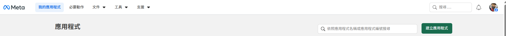
接下來輸入你想取的名字 信箱請填自己的  

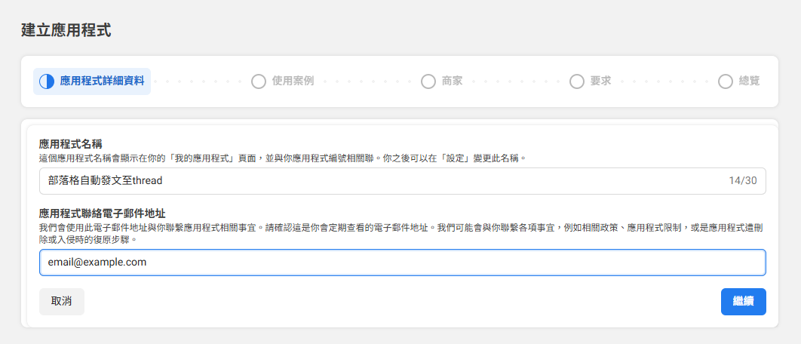
按`繼續`  

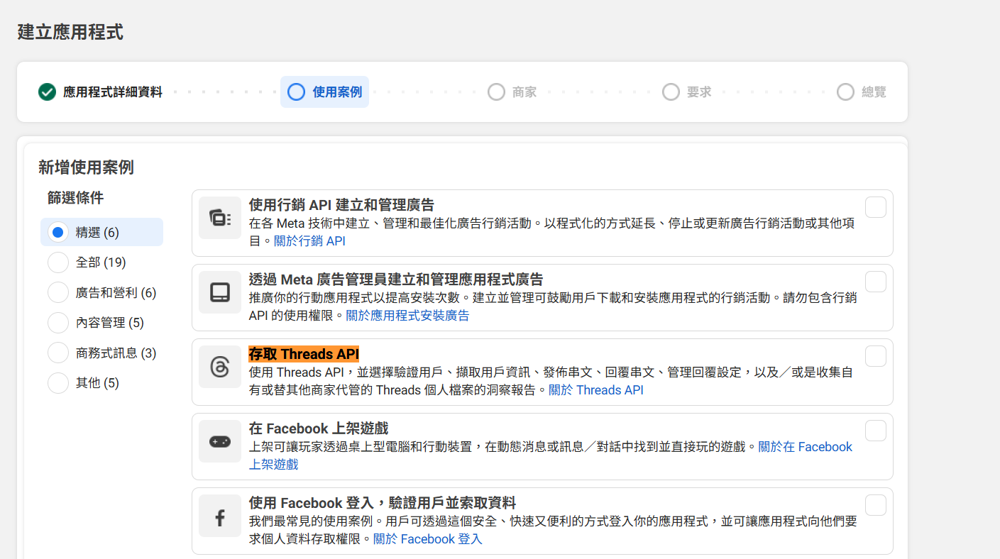
選`存取 Threads API` `繼續`  

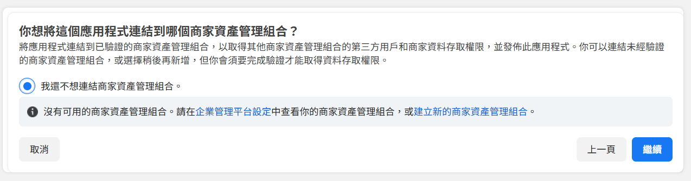
選`我還不想連結商家資產管理組合。` `繼續`  

## 第二步 建立測試角色

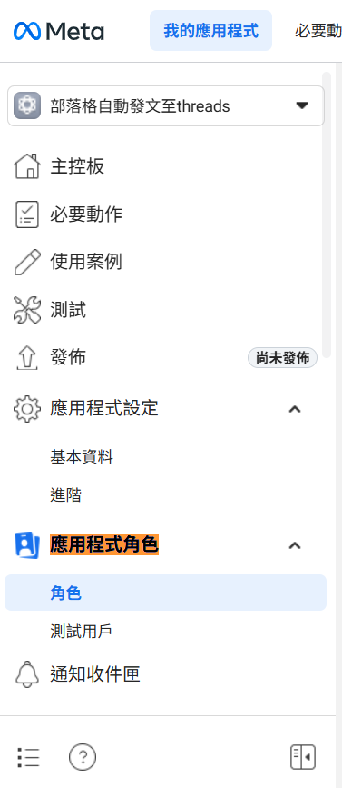  
到右下角的`應用程式角色`選`角色`  

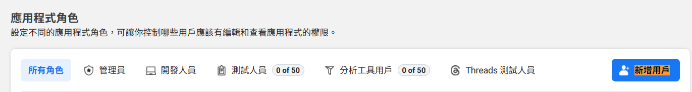
點`新增用戶`  

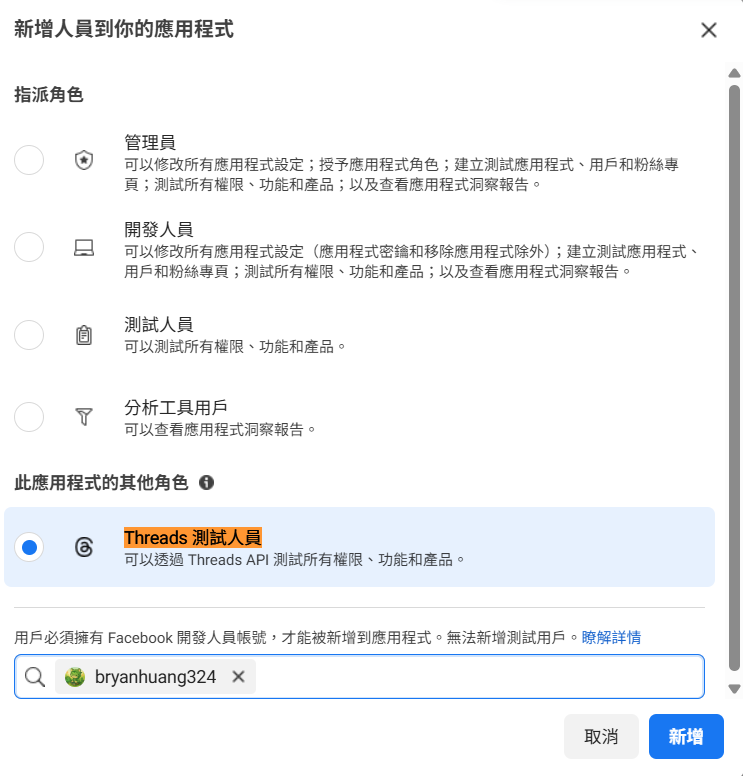
選`threads 測試人員` 並輸入自己的threads帳號  

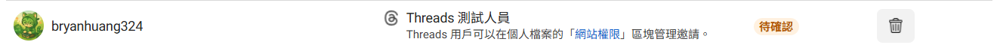
點`網站權限`  
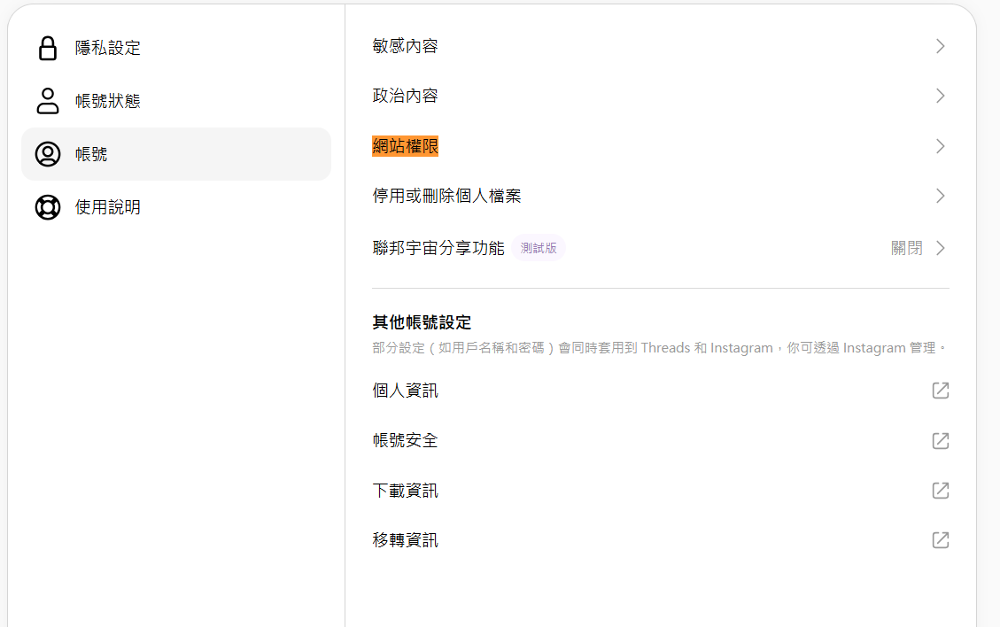
點`邀請` `接受`  
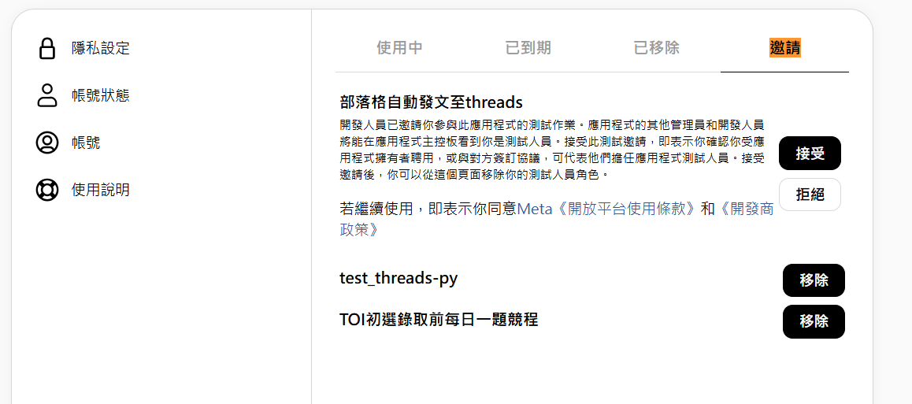  

## 第三步 測試
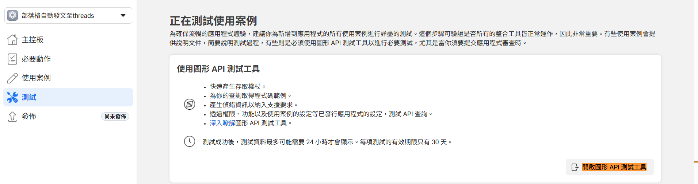
點`測試` `開啟圖形 API 測試工具`  

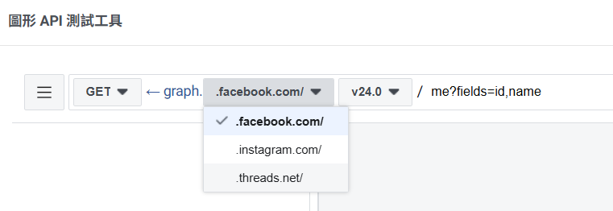
選`threads.net`  

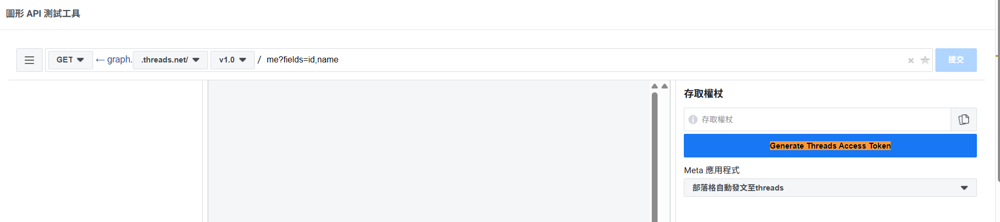
點`Generate Threads Access Token` 記得保密(這個是短效的Access Token)  
*點完以後點上面的`提交`可以拿到 `user_id`

### 申請長效Access Token
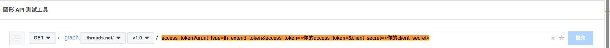
輸入`access_token?grant_type=th_exchange_token&access_token=<你的access_token>&client_secret=<你的client_secret>`
其中`<你的access_token>`為你剛申請的Access Token  
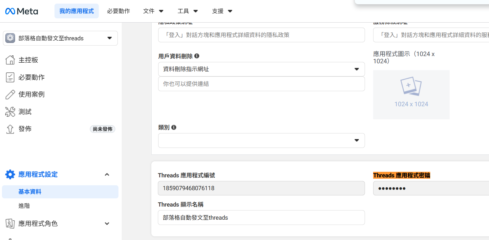
`<你的client_secret>`則要在剛剛的面板點`應用程式` `基本資料` `Threads 應用程式密鑰`  
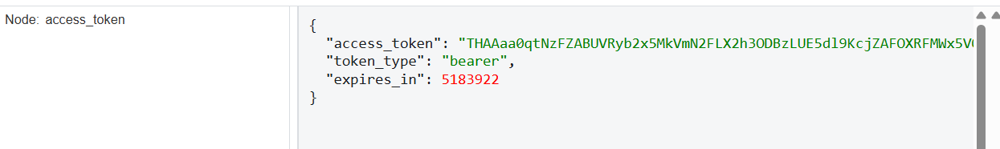
就會看到長效的access token了

## 總結
[user id 獲取](#get_user_id)
[申請長效Access Token](#申請長效Access-Token)
